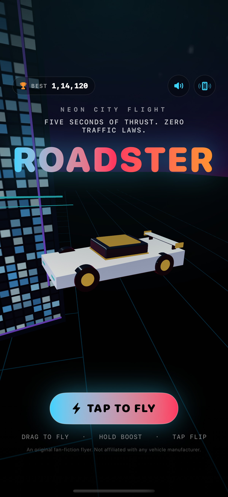
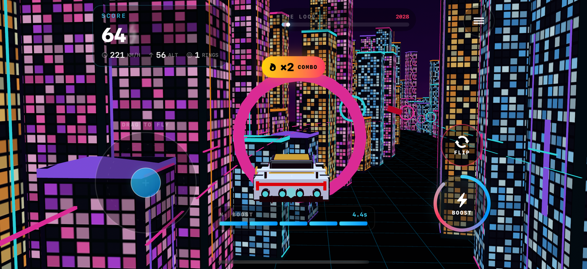
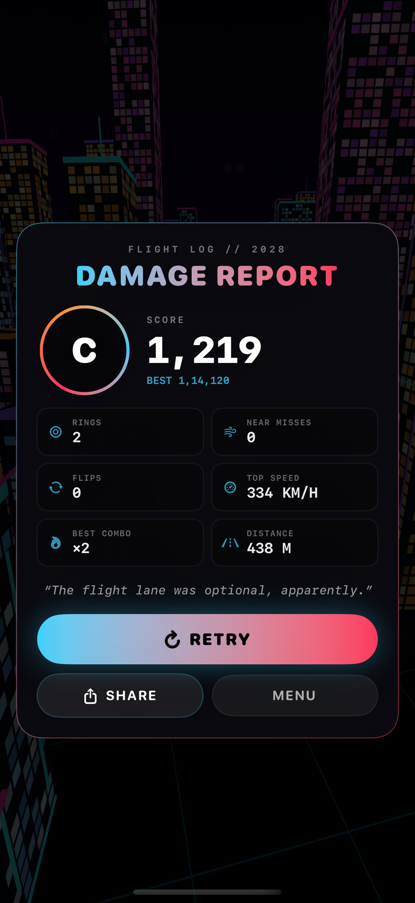
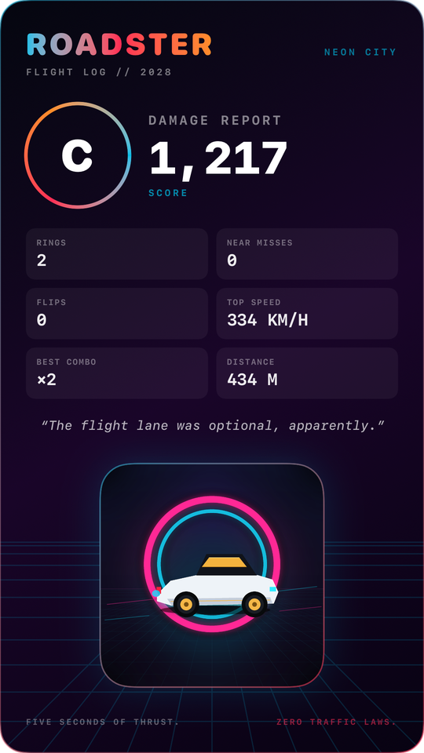

# Roadster

A native iOS arcade flying-car game set in a neon megacity. Fly a thruster-powered
roadster through a 6 km canyon of towers, thread neon rings, dodge traffic, boost,
kickflip, and chase a high score.

Built with **SwiftUI + RealityKit**, procedural geometry, and no third-party
libraries. Deployment target: **iOS 26.0**. Runs on iPhone and iPad in portrait and
landscape.



## The loop

- **6,000 m course** along an analytic flight path; finish gate at **5,940 m**.
- **30 neon rings** and **14 traffic cars** placed along the route.
- **5 seconds of nitrogen boost**; it refills slowly and is topped up by rings,
  near misses, and kickflips.
- **Combo multiplier** up to **×10** for rings, near misses, and flips.
- **Kickflip** for style points and a small boost refill.
- **Fan save**: one mid-air recovery from a traffic hit if you have boost left.
- Crash or finish into a **results card** with grade, stats, best combo, and a
  **shareable 1080×1920 score card**.
- Persistent **best score** and sound/haptics settings via `UserDefaults`.





The share card is rendered locally at 1080×1920 and handed to the system share
sheet; no server or account is involved.



## Controls

| Input | Action |
| --- | --- |
| Drag on the left steering pad | Fly: lateral and vertical movement |
| Hold **BOOST** | Burn nitrogen for extra speed and a bigger plume |
| Tap **FLIP** | Kickflip; also refills a little boost |
| Menu button (top right) | Return to the menu |

Keyboard/game-controller support is not required for the current build; the game
uses indirect input events and is designed for touch.

## Build

Requirements:

- Xcode **27.0** or newer (the project is generated with XcodeGen).
- iOS **26.0** SDK or newer.
- [XcodeGen](https://github.com/yonaskolb/XcodeGen) installed.

```bash
xcodegen generate
open Roadster.xcodeproj
```

Then select the **Roadster** scheme and an iPhone/iPad simulator or device. For a
device build, set your development team in the target's Signing & Capabilities
settings.

Command-line build:

```bash
xcodebuild \
  -project Roadster.xcodeproj \
  -scheme Roadster \
  -destination 'platform=iOS Simulator,name=iPhone 17 Pro' \
  -derivedDataPath DerivedData \
  build
```

The generated app is at
`DerivedData/Build/Products/Debug-iphonesimulator/Roadster.app`.

### UI tests

The `RoadsterUITests` target verifies the landscape menu/gameplay layout and the
crash-results flow, and captures screenshots:

```bash
xcodebuild test \
  -project Roadster.xcodeproj \
  -scheme Roadster \
  -destination 'platform=iOS Simulator,name=iPhone 17 Pro' \
  -derivedDataPath DerivedData \
  -resultBundlePath /tmp/RoadsterUITests.xcresult
```

### Debug launch flags

| Flag | Effect |
| --- | --- |
| `-autostart` | Skip the menu and start a flight immediately |
| `-demo` | Autopilot flies the course |
| `-crashdemo` | Force a traffic crash every 3 seconds while playing |

Example:

```bash
xcrun simctl launch <device-udid> com.ganeshrajugalla.Roadster -demo
```

## Architecture

```text
Roadster.xcodeproj          generated project (do not hand-edit)
project.yml                 XcodeGen source of truth
NeonRoadster/               app source folder (historical name)
├── RoadsterApp.swift       app entry
├── ContentView.swift       menu / game / HUD / results shell
├── Assets.xcassets/        app icon and accent assets
├── PrivacyInfo.xcprivacy   privacy manifest
└── Game/
    ├── GameSession.swift   flight model, boost, combo, scoring, crash, fan save
    ├── GameView.swift      RealityKit scene, fixed timestep, chase camera
    ├── CityBuilder.swift   merged city, facades, rings, traffic, finish gate
    ├── FlightPath.swift    analytic 6 km course
    ├── MeshBatch.swift     merged box/facade batches and procedural meshes
    ├── RoadsterEntity.swift procedural white roadster, wing, nozzles, plume
    ├── MenuView.swift      title screen and settings
    ├── HUDView.swift       score, speed, altitude, progress, boost, combo
    ├── TouchControlsView.swift steering pad, boost, flip
    ├── ResultsView.swift   results, share card, retry/menu
    ├── AudioEngine.swift   procedural AVFoundation audio
    ├── Haptics.swift       Core Haptics
    └── Random.swift        seeded RNG
RoadsterUITests/            XCUITest layout and crash-flow coverage
docs/                       research and screenshots
```

### Performance choices

- City buildings, neon strips, and facades are merged into a handful of meshes
  (`BoxBatch`, `FacadeBatch`) instead of hundreds of entities.
- Window facades use tiled, repeat-sampled textures; one draw per material batch.
- Fixed 120 Hz simulation step decoupled from render frame rate.
- Procedural meshes and textures avoid external 3D/texture assets.
- Bloom/tone mapping is enabled only when the runtime supports it; the game
  remains compatible with iOS 26.
- Camera is a level-horizon chase camera; no per-frame quaternion roll drift.

## Privacy

- No tracking, analytics, ads, accounts, or network calls.
- `UserDefaults` stores the best score and sound/haptics preferences only.
- `PrivacyInfo.xcprivacy` declares the UserDefaults required-reason API
  (`CA92.1`) and no collected data.

## Status

Verified with:

- iPhone 17 Pro simulator, iOS 27.0: menu, portrait/landscape gameplay, course
  clear, crash results, share-card render, and UI tests.
- iPad Pro 13-inch (M5) simulator, iOS 27.0: adaptive menu, portrait/landscape
  gameplay, results, and UI tests.

Not runtime-tested on this machine:

- iPhone Duo edge-to-edge behavior. The project uses adaptive layout, all four
  orientations, safe-area-aware controls, and no `UIRequiresFullScreen`; Duo
  runtime testing needs Xcode 27.1 / iOS 27.1.
- Haptics on physical hardware (Core Haptics is unavailable in the simulator).
- iOS 26.0 runtime (the installed simulator runtime is iOS 27.0; the deployment
  target is 26.0 and APIs are availability-checked).

## Name and brand note

Roadster is an original fan-fiction arcade flyer. It does **not** include Tesla or
SpaceX trademarks, logos, vehicle designs, or official assets. The working name
"Roadster" is a generic word, but trademark clearance for a commercial App Store
release is the publisher's responsibility.

## Next

- Run on a physical iPhone and iPad; verify haptics, audio, and frame pacing.
- Capture App Store screenshots for 6.9", 6.3", and iPad.
- Add Game Center leaderboards and daily seeded courses.
- Tune share-card copy and stats after testing on a physical device.
